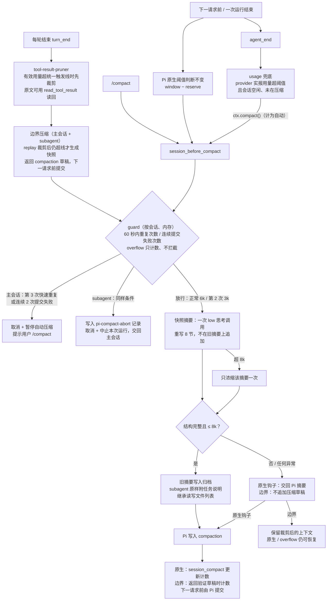

# newCompact-pi（pi-compact）

给 [pi](https://pi.dev) 用的上下文压缩插件。它把 Pi 自带的"在旧摘要上不断追加"改成"每次重写一份有长度上限的状态快照"，并且加了快速重复压缩熔断、基于真实用量的兜底触发，以及大工具结果裁剪。

**解决的问题**：Pi 自带的压缩，每次都把新内容并进旧摘要，从来不删。多次压缩后，摘要会从 1k 涨到 17k tokens 以上。压缩后的上下文起点越来越高，一压完马上又超线，形成反复压缩，最后上下文涨满、模型输出被截断。

## 运行逻辑



要点：

- **插件从不因为自己出错而取消原生压缩**。原生钩子的摘要模块遇到问题就交回 Pi 自带摘要；轮间摘要失败只是不追加压缩草稿，原生/overflow 恢复仍在。只有 guard 会取消压缩或中止 subagent。
- **细节不丢**。旧摘要会追加到归档文件，新摘要末尾写着归档位置，需要时再读。原始对话也一直保存在会话 JSONL 里。
- **压缩可逆**。归档文件真实存在时快照才写路径；首次没有旧摘要就不写假指针。恢复段后列出摘要掉的有效裁剪结果（最新最多 8 个 `entryId toolName originalChars: 关键片段`，每条片段 ≤120 字，整份清单 ≤200 token，超出显示 `+N more`），计入 8k 上限，可用 `read_tool_result(entryId, offset, limit)` 读回（需启用该工具）。无清单时只说明保留消息中仍可见的裁剪标记。
- **首条消息仅作上下文**。main 首条用户消息以 `Session's first user message (verbatim; may be superseded by later requests):` 保留，含标题/截断标记最多 600 tokens 并计入预算；Goal 必须写当前目标，后续请求可能已取代首条。subagent 仍保留父级任务简报（正文 ≤2000 tokens）。
- **摘要输入按档截断**。摘要输入不再用 Pi 原生序列化：工具结果头尾各留一段（bash 报错在尾部，不再丢），toolCall 参数按上限截（`write`/`edit` 文件正文、bash heredoc 不进摘要），超容量自动降到 tight 档（user 超长正文也按头 3000 / 尾 1000 字符截断，显式标注遗漏；full 保留 user 全文）再试一次，两档都不够才交回原生摘要。结构校验也只认那 8 个已知节：输出里多出的 `## Notes`、代码块里的 `## Goal`、标题尾随空格和 CRLF 都不再让整份快照作废。

## 安装

```bash
pi install git:github.com/Cheng-Zi-Qing/newCompact-pi
```

也可以克隆到本地，在 `~/.pi/agent/settings.json` 的 `packages` 里加本地路径。装好后，重开窗口或执行 `/reload` 生效。

卸载：

```bash
pi remove git:github.com/Cheng-Zi-Qing/newCompact-pi
```

**建议**：不要把 `compaction.reserveTokens` 设得很大。它只会压低触发线，对摘要能写多长没有任何作用。插件统一触发线是 `min(窗口 − reserveTokens, floor(窗口 × triggerRatio))`，默认 `triggerRatio=0.8`：1M / 200k / 128k 窗口、reserve=16,384 时分别为 800,000 / 160,000 / 102,400。32k 窗口、reserve=16,000 时为 16,000（reserve 限制更早）；若 reserve=16,384，则为 15,616。无需用超大的 reserve 替代比例阈值。

如果你另外装过其他压缩扩展（`session_before_compact` 钩子），请先停用，避免互相冲突。

## 行为说明

### 快照摘要

- 摘要固定是 8 个章节：Goal / Authorization & Constraints / Verified Progress / Unfinished Work & Blockers / Key Decisions / Active Agents & Session State / Evidence & Critical Context / Next Steps。
- 模型调用一次，通过 Pi 的 `modelRegistry.streamSimple` 发出（各家模型渠道和虚拟模型都由 Pi 统一处理），用 `low` 思考，输出上限 12,288 tokens，不缓存。
- 目标长度 6k，硬上限 8k。超出 8k 时，只把这份摘要再浓缩一次；还是超出，或者结构不对、模型出错、被中止、容量不够，原生钩子交回 Pi 自带摘要，轮间路径则不追加压缩草稿。
- 用户的授权和禁令原话保留并去重；已完成的事项每项一行；被推翻的决定、已结束的 agent、已解决的阻塞直接删除。

各章节预算（tokens）：

| 章节 | 主会话 | subagent |
|---|---:|---:|
| Goal | 300 | 任务说明原样附上（≤2000）+ 一两行当前目标 |
| Authorization & Constraints | 800 | 300 |
| Verified Progress | 1000 | 1000 |
| Unfinished Work & Blockers | 1000 | 1000 |
| Key Decisions | 800 | 800 |
| Active Agents & Session State | 500 | 100 |
| Evidence & Critical Context | 1200 | 1200 |
| Next Steps | 400 | 400 |

**subagent 的任务说明**：取子会话的第一条用户消息，原样附在 Goal 节。超过 2k tokens 时：

- 会话已写入文件：保留开头，并附上会话文件路径和条目 ID；
- 会话只在内存里：同样截断，并明确说明原文无可寻址位置。

### guard（熔断）

状态只放在内存里，每个会话单独计数。

- **快速重复计数**：自动压缩距上次自动压缩成功不到 60 秒，计数 +1；超过 60 秒清零。手动 `/compact` 不计数。
- **提交失败计数**：插件发起的压缩提交失败（不含被中止的），计数 +1；任意一次提交成功后清零。Pi 自己在没有调用插件时报的失败不计。
- **第 2 次快速重复**：本次摘要目标收紧到 3k。这是目标值，硬上限仍然是 8k。
- **第 3 次快速重复，或连续 2 次提交失败**：
  - **主会话**：取消这次压缩，并暂停自动压缩。状态栏会一直显示，警告只弹一次。手动 `/compact` 成功后解除暂停。
  - **subagent**：subagent 的提示用户看不到，所以不暂停，而是先在会话里写入一条 `pi-compact-abort` 记录（`reason` 为 `compression-loop` 或 `commit-failures`，带子会话 ID；不会发给模型），再中止这次运行，交回主会话决定续跑还是重新拆任务。
- **上下文溢出（overflow）从不拦截**：这时 Pi 已经删掉了失败的那条回复，要靠这次压缩后重试才能拿回回复；拦截的话这一轮会直接丢失。overflow 仍然计入快速重复次数。

**subagent 会话的判断**：如果会话里有 `model-route-state` 条目（由 pi-subagents-route 这类路由插件写入），以其 `contextRole` 为准，`main` 即主会话；没有这个条目时，会话头带 `parentSession` 字段就当作 subagent。`/fork` 和分支出来的会话也带 `parentSession`，但它们复制了主会话的路由条目，所以仍按主会话处理。

### 统一触发线与有效用量

主会话和 subagent 都使用 `min(窗口 − reserveTokens, floor(窗口 × triggerRatio))`。`reserveTokens` 和 `keepRecentTokens` 仍读取 Pi 的 compaction 配置；`triggerRatio` 默认 0.8，可在 Pi 的 `settings.json` 设置：

```json
{
  "piCompact": { "triggerRatio": 0.8 }
}
```

比例必须是 0.5–0.95 之间的有限数字。无设置时用默认值；无效值回退到 0.8，每个会话只警告一次。插件通过 `pi.getSettings()` 读取，不自行修改用户配置。

有效用量取最新有效 assistant 的 provider 实报值，减去其后 context_edits 裁掉部分的估算量，再加上该回复之后的投影消息估算。裁剪后仍保留 provider 基线；工具结果重复编辑按该次 provider 请求实际看到的内容核算，不重复扣除。没有可用实报（如之后已压缩、回复被省略或裁剪无法核算）才回退 Pi 的投影估算。

Pi 1.4.0 本来就会在运行中的两轮请求之间压缩，但 context_edit/compaction 出现在最后一次 usage 之后时，它会放弃实报基线而采用纯字符估算；状态栏的 `getContextUsage()` 也一样。因此在 1M 会话里，Pi / 状态栏可能显示约 540k，而 provider 实际用量已约 1M。插件的判断不再依赖这个偏低的数字；默认 80% 线也给下一轮数万 tokens 的增长留余量。

稳定导出位于 `src/usage.ts`：`compactionLine(window, reserve, ratio)`、`effectiveContextTokens(branch, projection?)`，以及配置解析函数 `getTriggerRatio(settings, warn?)`，可供其他插件复用。

### 轮间边界压缩

- manifest 先加载 pruner，再加载 compact。在 `turn_end`、`outcome=completed` 时，先裁剪，后用 replay 后的投影重算有效用量；裁剪已足够就不调用摘要模型。
- 若仍超线，运行与 `session_before_compact` 共用的 guard：主会话照常取消/暂停；subagent 照常写入 `pi-compact-abort` 并 `ctx.abort()`。正在压缩、已有 compaction 草稿、自动压缩关闭或无安全切点时跳过。
- 使用公开 `findCutPoint` 在裁剪后的消息上按 `keepRecentTokens` 留尾，绝不在工具结果上切断。复用 `summarize()` 的快照、brief、归档、文件列表、6k/3k 预算和 8k 硬上限。
- 返回 compaction 草稿，不在运行中调用会中止任务的 `ctx.compact()`。Pi 在下一轮请求准备前提交草稿并刷新投影；验证压缩后投影低于插件线（同时低于原生线）才返回，因此抢在原生阈值前处理而不立即双重压缩。
- 摘要或预览失败时保留裁剪、不追加压缩草稿，记录 `boundary-fallback:<reason>`；摘要尝试失败计入 guard 失败计数，中止不计。Pi 原生压缩与 overflow 恢复仍在。

### agent_end 兜底

- 在 `agent_end` 时检查同一有效用量与触发线，并在延迟执行前重查。轮间草稿已提交后，旧 usage 过期，不会拿压缩前的实报立刻再压一次。
- Pi 原生压缩的阈值仍为 `窗口 − reserve`；插件的 pruner、轮间压缩和 agent_end 兜底都采用上述统一线。
- 以下情况不触发：
  - 设置里关闭了自动压缩（`compaction.enabled: false`）；
  - 既没有可用 provider 实报，回退后的投影用量也未超线；
  - 会话不空闲，或正在压缩（避免打断进行中的工作）；
  - guard 正处于暂停；
  - 距上次尝试不到 120 秒（节流）。
- 它触发的压缩在 guard 里按自动压缩计数。

### tool-result-pruner

- 每轮结束时，如果有效用量超过统一触发线，从最早的大工具结果开始裁剪：超过 8192 字符的，只保留开头 4096 和结尾 1024。最新一轮用户消息之后的内容不动。
- 原文仍在会话里，模型可以用 `read_tool_result` 按需读回。
- 如果当前会话没有启用 `read_tool_result`（比如工具白名单里没有它），就不裁剪，因为裁掉的内容将无法找回。

## 文件与排查

| 内容 | 位置 |
|---|---|
| 日志 | `<agentDir>/pi-compact.log`（`<agentDir>` 通常为 `~/.pi/agent`，遵循 `PI_CODING_AGENT_DIR`） |
| 归档 | `<agentDir>/compaction-archive/<sessionId>.md` |
| 改目录 | 设置环境变量 `PI_COMPACT_DIR`，上面两项会改写到该目录下 |

日志超过 5 MB 时，下次写入前轮换到 `pi-compact.log.1`，覆盖旧备份。

日志每行一次事件，主要字段：

- `sub`：是否 subagent 会话
- `reason`：触发原因，`manual` / `threshold` / `overflow`
- `streak`：guard 计数
- `budget`：本次摘要的目标预算
- `tokensBefore`：压缩前的 token 数
- `summaryTokens`：摘要估算 tokens
- `result`，可能的值：

| result | 含义 |
|---|---|
| `ok` / `condensed` | 插件摘要成功 / 浓缩后成功 |
| `fallback:<原因>` | 交回 Pi 自带摘要；原因为 capacity、structure、stop:length、over-cap、aborted 等 |
| `committed` | 压缩已写入会话；`fromExtension=false` 表示用的是 Pi 自带摘要；`reason=untracked:*` 表示不是插件发起的 |
| `commit-failed` | 提交失败，附带是否被中止、当前连续失败次数（`failStreak`）和错误信息 |
| `cancel:rapid-loop` / `cancel:commit-failures` / `cancel:paused` | 主会话进入暂停（快速重复 / 连续提交失败）/ 暂停期间被拦截 |
| `abort:compression-loop` / `abort:commit-failures` | subagent 被中止 |
| `usage-trigger` | agent_end 兜底触发（`limit` 为统一触发线） |
| `boundary-compact` | 轮间 compaction 草稿已生成并验证预览；附有效用量 `tokensBefore`、投影用量 `tokensAfter` 和 `limit` |
| `boundary-fallback:<原因>` / `boundary-skip:<原因>` | 轮间摘要/预览失败或跳过；失败不追加压缩草稿 |
| `usage-skip:disabled` / `:paused` / `:busy` / `:resolved` | usage 兜底跳过：自动压缩已关闭 / 处于暂停 / 会话不空闲或正在压缩 / 已不再超线 |

按次统计某个会话的压缩情况（只读）：

```bash
node scripts/report.mjs ~/.pi/agent/sessions/<目录>/<会话>.jsonl
```

输出每次压缩的时间、来源（插件 / 原生）、压缩前 token 数、摘要大小、压缩后首轮请求用量、与上次的间隔，以及输出被截断的次数。

## 测试

```bash
npm test   # 先生成仅供测试用的 tsconfig.json（已被 gitignore），再运行 bun test
```

- 需要 [bun](https://bun.sh) 和本机安装的 pi。测试宿主包依次从 `PI_GLOBAL_NODE_MODULES`、`PI_MANAGED_INSTALL_ROOT`（默认 `~/.pi/agent/install`）的 `releases/<current-version>/node_modules`、默认安装目录的同类发布路径、`~/.bun/install/global/node_modules` 解析，选第一个含 pi 包的目录；找不到时会列出尝试的路径。
- `tests/boundary-sdk.test.ts` 用真实 Pi 1.4.0 extension loader、SessionManager 和两轮离线模型请求验证 pruner → compaction 草稿提交 → 下一轮投影刷新，并断言主会话/subagent 都只生成一次快照、没有原生双重压缩。所有 fixture/日志/模型运行数据位于临时目录，不写用户 agentDir。
- `tests/estimate.consistency.test.ts` 是**常驻回归测试**。插件用公开接口重新实现了 Pi 内部的上下文 token 估算（内部函数没有导出），这个测试拿它和当前安装的 Pi 内部实现，在构造场景和本机最新的会话文件上逐一比对。**每次升级 Pi 后都要重跑**，结果不一致说明 Pi 改了估算规则，需要同步更新插件。

## 已知限制

- provider 实报之后的增量、裁剪 savings 和压缩后的上下文仍须估算；80% 余量不是任意大单轮或单消息永不溢出的保证。没有可用实报时仍可能低估，原生 overflow 是最后恢复路径。
- 轮间路径只处理 completed 边界；错误/中止轮、恢复省略尾段、包含多个投影消息的特殊条目或残留旧 compaction 的复杂投影会安全回退，不猜测切点。这些形状由 Pi 原生压缩/overflow 处理。
- Pi 没有边界草稿提交成功的 extension 回调。guard 在返回已验证草稿时更新成功计数；若后续其他扩展撤换草稿或 Pi 落盘失败，计数/归档可能领先实际提交。`boundary-compact` 日志不是落盘证明，应核对会话 JSONL 中的 compaction 条目。
- `keepRecentTokens` 太大，导致生成快照后的投影仍不低于统一线时，轮间路径记录 `boundary-fallback:no-reduction` 而不返回草稿，避免马上被原生再压一次；小窗口需配合合理的留尾预算。
- 改 manifest 顺序只对按本包 manifest 加载生效；手动分别加载两个扩展也必须先 pruner 后 compact。
- guard 状态只在内存里，重启或 `/reload` 后清零。
- 主会话暂停期间，如果一直不处理，上下文仍会继续增长。这是有意的取舍，避免压缩循环白白消耗 token。
- subagent 被中止时，原因写在子会话的 `pi-compact-abort` 记录和日志里；主会话一侧只看到"运行被中止"，要识别原因需要主会话那边自己去读这条记录。
- 不落盘的嵌套 subagent，如果既没有 `parentSession`，也没有路由插件写入的角色标记，会被当成主会话处理（连续压缩时暂停，而不是中止）。
- 子会话的任务说明取的是第一条用户消息。如果派任务时带上了父会话的上下文，开头会是那段上下文；截断时，真正的任务说明可能被截掉。
- 回退到 Pi 自带摘要的那一次，不会继承插件生成的文件读写列表。
- 单条消息本身超过上下文窗口时，tight 会保留 user 文本头尾，但仍可能因总输入/固定预留超限而回退；不保证任意大输入都能压缩。
- 归档在结构、8k、abort 与边界 no-reduction 校验通过后、实际提交前写入；尾部指针/恢复段/清单预先从首次与浓缩模型预算扣除（预算最低 3k），恢复清单自身有固定上限并带关键片段，所以它是被预留的而不是被最先牺牲的：超 8k 时溢出量不超过清单就先丢清单（不调模型），否则先浓缩一次，仍超再去掉独立 `Older details:` 行，最后才回退。写失败复用已得输出：已有归档保留路径并说明最新快照追加失败，无文件才说明未归档且不写路径。如果 Pi 随后提交失败，归档仍可能留下重复段落，所以归档内容不能当作压缩已成功的证据。
- token 估算比较保守（中文按每字 1 token），中文多的会话可能更常因容量检查回退到 Pi 自带摘要。
