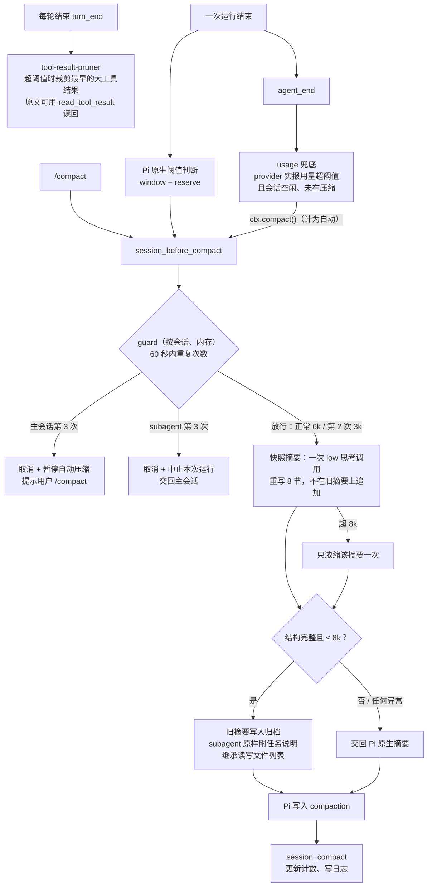

# newCompact-pi（pi-compact）

给 [pi](https://pi.dev) 用的上下文压缩插件。它把 Pi 自带的"在旧摘要上不断追加"改成"每次重写一份有长度上限的状态快照"，并且加了快速重复压缩熔断、基于真实用量的兜底触发，以及大工具结果裁剪。

**解决的问题**：Pi 自带的压缩，每次都把新内容并进旧摘要，从来不删。多次压缩后，摘要会从 1k 涨到 17k tokens 以上。压缩后的上下文起点越来越高，一压完马上又超线，形成反复压缩，最后上下文涨满、模型输出被截断。

## 运行逻辑



要点：

- **插件从不因为自己出错而取消压缩**。摘要模块遇到任何问题都交回 Pi 自带摘要；只有 guard 会取消压缩。
- **细节不丢**。旧摘要会追加到归档文件，新摘要末尾写着归档位置，需要时再读。原始对话也一直保存在会话 JSONL 里。

## 安装

```bash
pi install git:github.com/Cheng-Zi-Qing/newCompact-pi
```

也可以克隆到本地，在 `~/.pi/agent/settings.json` 的 `packages` 里加本地路径。装好后，重开窗口或执行 `/reload` 生效。

卸载：

```bash
pi remove git:github.com/Cheng-Zi-Qing/newCompact-pi
```

**建议**：不要把 `compaction.reserveTokens` 设得很大。它只会压低触发线，对摘要能写多长没有任何作用。默认的 16384 就够用：128k 窗口下，触发线约 111k。

如果你另外装过其他压缩扩展（`session_before_compact` 钩子），请先停用，避免互相冲突。

## 行为说明

### 快照摘要

- 摘要固定是 8 个章节：Goal / Authorization & Constraints / Verified Progress / Unfinished Work & Blockers / Key Decisions / Active Agents & Session State / Evidence & Critical Context / Next Steps。
- 模型调用一次，用 `low` 思考，输出上限 12,288 tokens，不缓存。
- 目标长度 6k，硬上限 8k。超出 8k 时，只把这份摘要再浓缩一次；还是超出，或者结构不对、模型出错、被中止、容量不够，都交回 Pi 自带摘要。
- 用户的授权和禁令原话保留并去重；已完成的事项每项一行；被推翻的决定、已结束的 agent、已解决的阻塞直接删除。

各章节预算（tokens）：

| 章节 | 主会话 | subagent |
|---|---:|---:|
| Goal | 300 | 任务说明原样附上（≤2000）+ 一两行当前目标 |
| Authorization & Constraints | 800 | 300 |
| Verified Progress | 1000 | 1000 |
| Unfinished Work & Blockers | 1000 | 1000 |
| Key Decisions | 800 | 800 |
| Active Agents & Session State | 500 | 100 |
| Evidence & Critical Context | 1200 | 1200 |
| Next Steps | 400 | 400 |

**subagent 会话的判断**：会话头带 `parentSession` 字段，或者有 `model-route-state` 条目且其 `contextRole` 不是 `main`（由 pi-subagents-route 这类路由插件写入）。

**subagent 的任务说明**：取子会话的第一条用户消息，原样附在 Goal 节。超过 2k tokens 时：

- 会话已写入文件：保留开头，并附上会话文件路径和条目 ID；
- 会话只在内存里：保留全文，仍然受 8k 硬上限约束。

### guard（快速重复压缩熔断）

状态只放在内存里，每个会话单独计数。

- **计数方式**：自动压缩距上次自动压缩成功不到 60 秒，计数 +1；超过 60 秒清零。手动 `/compact` 不计数。
- **第 2 次**：本次摘要目标收紧到 3k。这是目标值，硬上限仍然是 8k。
- **第 3 次，主会话**：取消这次压缩，并暂停自动压缩。状态栏会一直显示，警告只弹一次。手动 `/compact` 成功后解除暂停。
- **第 3 次，subagent**：subagent 的提示用户看不到，所以不暂停，而是中止这次运行，交回主会话决定续跑还是重新拆任务。

### usage 兜底

- 在 `agent_end` 时检查 provider 实际报告的用量。Pi 的估算会漏掉加密的推理 token，尤其是会话里有 context_edit 的时候。
- 超过 `窗口 − reserve`（读取实际配置）才触发。
- 以下情况不触发：
  - 这份用量之后已经有压缩或裁剪（用量已过期）；
  - 会话不空闲，或正在压缩（避免打断进行中的工作）；
  - guard 正处于暂停；
  - 距上次尝试不到 120 秒（节流）。
- 它触发的压缩在 guard 里按自动压缩计数。

### tool-result-pruner

- 每轮结束时，如果上下文超过阈值，从最早的大工具结果开始裁剪：超过 8192 字符的，只保留开头 4096 和结尾 1024。最新一轮用户消息之后的内容不动。
- 原文仍在会话里，模型可以用 `read_tool_result` 按需读回。
- 如果当前会话没有启用 `read_tool_result`（比如工具白名单里没有它），就不裁剪，因为裁掉的内容将无法找回。

## 文件与排查

| 内容 | 位置 |
|---|---|
| 日志 | `~/.pi/agent/pi-compact.log` |
| 归档 | `~/.pi/agent/compaction-archive/<sessionId>.md` |
| 改目录 | 设置环境变量 `PI_COMPACT_DIR`，上面两项会改写到该目录下 |

日志每行一次事件，主要字段：

- `sub`：是否 subagent 会话
- `reason`：触发原因，`manual` / `threshold` / `overflow`
- `streak`：guard 计数
- `budget`：本次摘要的目标预算
- `tokensBefore`：压缩前的 token 数
- `summaryTokens`：摘要估算 tokens
- `result`，可能的值：

| result | 含义 |
|---|---|
| `ok` / `condensed` | 插件摘要成功 / 浓缩后成功 |
| `fallback:<原因>` | 交回 Pi 自带摘要；原因为 capacity、structure、stop:length、over-cap、aborted 等 |
| `committed` | 压缩已写入会话；`fromExtension=false` 表示用的是 Pi 自带摘要 |
| `commit-failed` | 提交失败，附带是否被中止和错误信息 |
| `cancel:paused` / `abort:compaction-loop` | guard 暂停 / subagent 被中止 |
| `usage-trigger` / `usage-skip:*` | usage 兜底触发 / 跳过 |

按次统计某个会话的压缩情况（只读）：

```bash
node scripts/report.mjs ~/.pi/agent/sessions/<目录>/<会话>.jsonl
```

输出每次压缩的时间、来源（插件 / 原生）、压缩前 token 数、摘要大小、压缩后首轮请求用量、与上次的间隔，以及输出被截断的次数。

## 测试

```bash
npm test   # 先生成仅供测试用的 tsconfig.json（已被 gitignore），再运行 bun test
```

- 需要 [bun](https://bun.sh)，并且本机全局安装了 pi。宿主包默认从 `~/.bun/install/global/node_modules` 解析，可以用 `PI_GLOBAL_NODE_MODULES` 改路径。
- `tests/estimate.consistency.test.ts` 是**常驻回归测试**。插件用公开接口重新实现了 Pi 内部的上下文 token 估算（内部函数没有导出），这个测试拿它和当前安装的 Pi 内部实现，在构造场景和本机最新的会话文件上逐一比对。**每次升级 Pi 后都要重跑**，结果不一致说明 Pi 改了估算规则，需要同步更新插件。

## 已知限制

- guard 状态只在内存里，重启或 `/reload` 后清零。
- 主会话暂停期间，如果一直不处理，上下文仍会继续增长。这是有意的取舍，避免压缩循环白白消耗 token。
- subagent 被中止时，主会话只看到"运行被中止"，看不到原因；原因写在日志里。
- 不落盘的嵌套 subagent，如果既没有 `parentSession`，也没有路由插件写入的角色标记，会被当成主会话处理。
- 子会话的任务说明取的是第一条用户消息。如果派任务时带上了父会话的上下文，开头会是那段上下文；截断时，真正的任务说明可能被截掉。
- 回退到 Pi 自带摘要的那一次，不会继承插件生成的文件读写列表。
- 单条消息本身就超过上下文窗口时，插件和 Pi 自带摘要都会失败。
- 归档在提交前写入。如果 Pi 随后提交失败，归档里可能留下重复段落，所以归档内容不能当作压缩已成功的证据。
- token 估算比较保守（中文按每字 1 token），中文多的会话可能更常因容量检查回退到 Pi 自带摘要。
